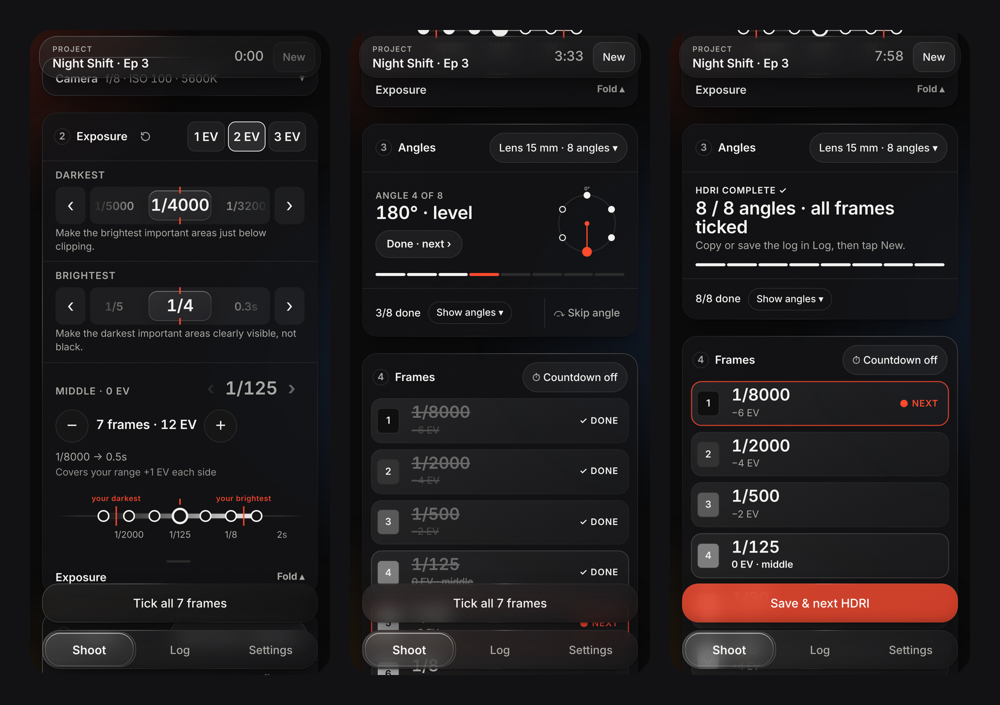
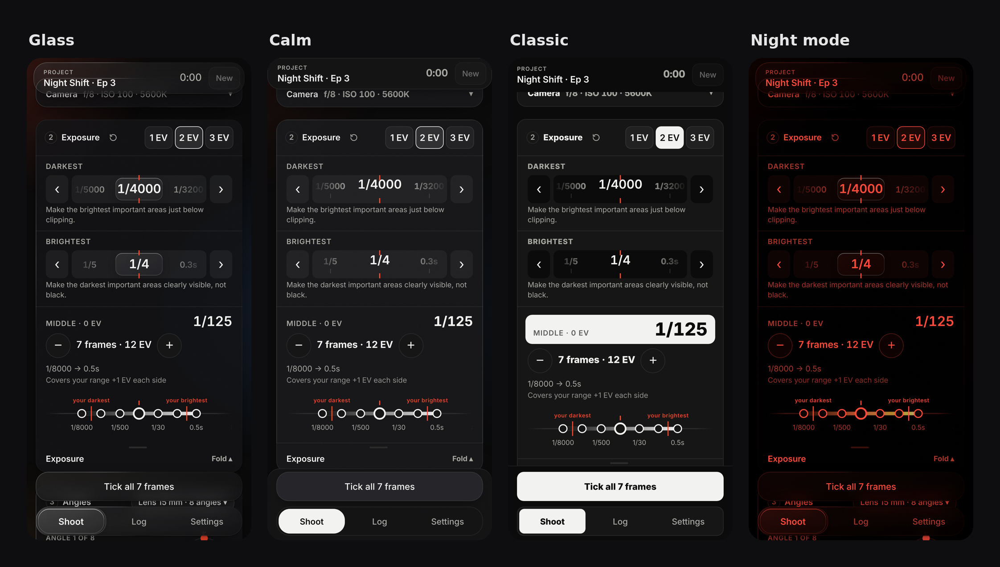
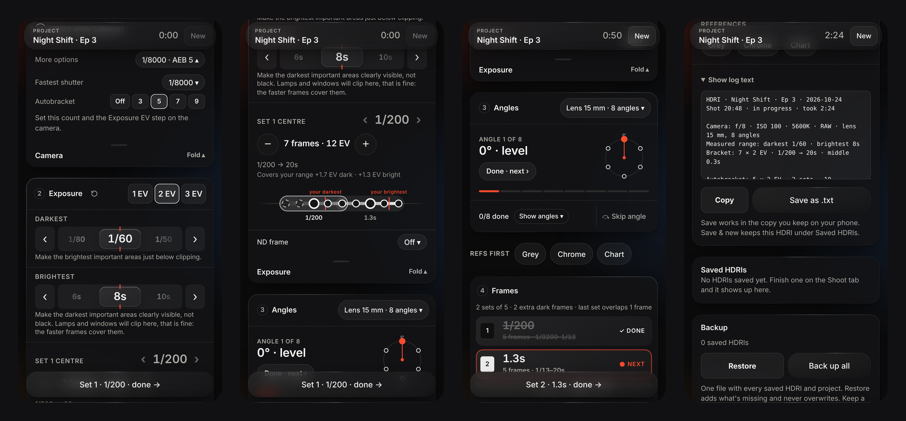

  <picture>
    <source media="(prefers-color-scheme: dark)" srcset="logo-dark.svg">
    
  </picture>

A free on-set companion for shooting HDRIs. Set your darkest and brightest exposure, and it builds the bracket, walks you through every angle and keeps a log of every HDRI you shoot.

**Use it:** https://suspenseandsurprise.github.io/Hdri-bracket-app/

Open it in Chrome on your phone and use ⋮ → Install app. It works offline after that.

## What it does

- Builds the exposure bracket from your darkest and brightest frame
- Walks you through every angle for your lens and tracks what's done
- Autobracket sets for cameras that can't bracket the whole range (see below)
- ND frame: enter your ND as printed on the filter and see what it adds (see below)
- Single shot mode for textures and plates (see below)
- Presets for your camera and lens setup (see below)
- Fastest shutter setting (up to 1/32000) and shifting the middle of the bracket
- Notes, location (by hand or automatic) and a log for every HDRI, with a report you can copy
- Optional countdown timer for long exposures
- Built-in how-to under Settings, including a head that can't point straight up or down, the tripod and ground, and a few things to remember
- Themes (Glass, Calm, Classic), Light/Dark/Auto, night mode and sun mode

**Walkthrough video:** see the latest release.

## Autobracket sets

Splits the bracket into sets of 3, 5, 7 or 9 frames, with the centre shutter to dial in for each set.

- The camera always fires a full set, so a set can have spare frames.
- Spare frames go to the slow end while the slowest frame stays at 1 s or shorter (cleaner shadows, nearly free).
- Beyond 1 s they go to the fast end, so no long exposure is wasted.

## Single shot

For textures and plates, at one angle. Pick it under Angles, then choose:

| Shot as | What you shoot |
|---|---|
| Bracket | Your HDRI exposure range, at this one angle |
| One frame | One shutter of its own; your HDRI range stays as it is |

Done logs exactly what you shot. A small icon next to the timer shows the mode: a ring for HDRI, stacked frames for Single · bracket, one frame for Single · one frame.

## Presets

A preset stores parts of your setup. Exposure and project are never stored.

| Mode | Parts you can store |
|---|---|
| HDRI | Fastest shutter, autobracket, lens & angles, ISO, white balance, aperture |
| Single shot | ISO, white balance, aperture, Bracket or One frame (with its shutter) |

- **Apply:** tap a preset in the Camera card. Tap it again for no preset. Each preset shows at a glance what it sets.
- **Save:** Settings → Save current setup. Name it (up to 40 characters; your lens name is suggested) and pick what goes in.
- **Update:** changed something after picking one? Update next to it saves that back. To overwrite another, use Save current setup → Or replace.
- **Edit:** rename, add or drop parts, copy an HDRI preset to Single shot (ISO, white balance and aperture, set to Bracket), export or delete.
- **Modes:** a preset belongs to the mode you saved it in. The Camera card shows only that mode's presets; Settings lists all of them with a mode tag and greys out the other mode's.
- **Share:** Export all and Import .json at the bottom of Presets (one .json file). Edit exports a single preset.
- **Undo** works for every save, update and delete.

## Your lens and crop sensors

The angle plans are in full-frame focal lengths. Type your own lens under Angles, and if the name has a focal length and a sensor word, the app converts it, picks the matching lens type and shows the full-frame equivalent:

> Fujifilm xe4 23mm apsc → Your lens ≈ **35 mm** full frame (23 mm on APS-C, ×1.5)

| Type in the name | Crop |
|---|---|
| APS-C, APSC, DX, XF, XC, DT, DC, DA, Super 35, S35 | ×1.5 |
| EF-S, RF-S, Canon APS-C | ×1.6 |
| APS-H | ×1.3 |
| MFT, M4/3, M43, Micro Four Thirds | ×2 |
| 1-inch, 1" | ×2.7 |
| Your own factor: ×1.5, x1.6, crop 1.6 | as typed |

- No sensor word means full frame, so "Sony 14mm" stays 14 mm.
- Zooms count at their widest end (10-18 mm → 10 mm). The aperture is ignored.
- Add "fisheye" for fisheye lenses.
- Mount names on their own (E, Z, RF, EF, X) don't count, because they don't tell the sensor size.
- Works in Single shot mode too, and the equivalent goes into the report.

## ND filter

Type the strength the way it's printed on the filter: stops (3), density (0.9) or factor (ND8). The app converts it to stops. Every 0.3 of density is one stop, and ND8 lets through 1/8 of the light, which is also 3 stops.

## Privacy

No account, no tracking, nothing leaves your phone. Everything is stored on the device. The font (Archivo, SIL Open Font License, see `OFL.txt`) ships with the app, so no request goes to Google or any other server.

## Run it yourself

The whole app is a single HTML file, `hdri-bracket.html`. Download it from [Releases](../../releases) and open it in a browser. Installing it as an app and the offline mode need the hosted version (or any https page).

## Updating

Open the app online once and it updates itself. Settings shows the version (date · hash) so you can check you have the latest build.

## Feedback

Issues and suggestions are welcome, especially from people who shoot HDRIs regularly.

Made with the help of AI.
